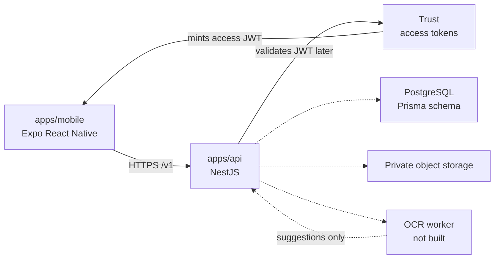

# Property Control

Property Control is a Mexico-first portfolio OS for people who own more than one property. It tracks what is owed, when it is due, what was paid, and the proof: predial, CFE, water, mortgages and their documents, plus the other recurring obligations on a property.

The product **records** payments a person already made. It does **not** move money. There is no wallet, payout, bank connection, or payment rail in this repository, and none of those belong in the MVP.

The client is Spanish-first. The API uses English `snake_case` enum values so clients can render Spanish labels (Predial, Agua, Electricidad / CFE, and the rest).

This repository is the greenfield monorepo: a NestJS API stub, an Expo React Native shell, and the project docs. Persistence, authorization, and the OCR confirm screen are specified and not built yet.

## Source of truth

Product and design decisions live in these Drive documents. This repo follows them. If a doc and the code disagree, the doc wins until Product changes it. Edge cases for the public product, DueRecord, are locked in [docs/EDGE_CASES.md](docs/EDGE_CASES.md). Where that spec and another doc disagree, the spec wins.

| Doc | Link |
| :---- | :---- |
| Product brief confirmed v1.1 | https://docs.google.com/document/d/1F_DSJG5Fo6G3WXyGXJWyqscMp8LC9SbEqgGj-c68ric/edit |
| Backend formal v0 | https://docs.google.com/document/d/1iekHZp5lOq4qTzLhglFproL2JSeI7Uw1q4I817d40dE/edit |
| UX screen inventory | https://docs.google.com/document/d/1zrz46A2NuD58ZTcYbNxdmGeEFN3HeVxPJORLHRAp4lc/edit |
| UX Home | https://docs.google.com/document/d/1qfOiEdU3pNBnE21VF0i6nOFW1OLqhppGsl6tet-gIlA/edit |
| UX Property detail | https://docs.google.com/document/d/10lVbzuoaI1cANrXI6YDaO2D0mxHgQSnbQNaSajKvH4g/edit |

Related drafts linked from the product brief: [record payment](https://docs.google.com/document/d/115D22oPSVl6qR4PlyE8biA3qMzH1JFRcmjvmi3QZ3og/edit) and [Trust architecture](https://docs.google.com/document/d/1zbIoIroBNVOhfsX48RmP2Gac2ggZnjbsJBWgxxo6F9E/edit).

## Core loop

**Configure → Remind → Record → Prove → Repeat**

1. Add properties and obligations.
2. Remind before the due date. The default offsets are **7 days and 1 day**.
3. Record a payment the person already made.
4. Attach evidence (a comprobante) when they have one. Evidence is **optional**.
5. The schedule moves forward when the period is fully paid or marked not applicable.
6. On a document upload, especially a mortgage, OCR **suggests** fields. The person **confirms** (and may edit) before anything is written. A finished OCR job does not change an obligation or a payment by itself.

## Non-goals

Out of the MVP, and out of this scaffold:

- Charging a card, moving funds, holding a balance, payouts, or any payment rail
- Bank aggregation or Open Banking
- Condo administration, full accounting, tax filing, municipal portal integrations
- Listings, tenant screening, and legal lease workflows
- Deleting a payment. A correction is a void, specified in [docs/EDGE_CASES.md](docs/EDGE_CASES.md)
- Writing OCR suggestions onto Obligation or Payment without an explicit confirm request
- Public or permanent URLs for receipts and documents

See [ADR 0001](docs/adr/0001-tracking-not-money-movement.md) and [ADR 0002](docs/adr/0002-ocr-suggest-then-confirm.md).

## Entities

| Entity | Role |
| :---- | :---- |
| User | Local row for a Trust subject. No password stored here. |
| PropertyMembership | Who can access a property, and as which role. |
| Property | One unit in the portfolio. |
| Obligation | The rule: category, amount, recurrence, next due date, reminder offsets. |
| Payment | An event that covers some or all of an obligation period. Status is `recorded` or `voided`. There is no delete. |
| Evidence | Optional private file for a payment (or a maintenance task). |
| MaintenanceTask | Light maintenance tracking. |
| Document | Private file on a property (deed, mortgage, policy, and so on). |
| Reminder | A scheduled notification for an obligation or a task. |
| OcrJob | Extract job for a document. `pending` → `processing` → `suggested` → `confirmed` or `rejected` or `failed`. |
| OcrSuggestion | One suggested field. `pending` → `accepted` or `rejected`. |

Supporting rows in the Prisma schema, from Backend formal v0: `ObligationPeriodOutcome`, `AuditEvent`, and `IdempotencyRecord`. Field-level detail is in [docs/DATA-MODEL.md](docs/DATA-MODEL.md).

Three obligation states stay distinct:

| Action | What changes |
| :---- | :---- |
| Marcar no aplica | This period only. Outcome `not_applicable`. `nextDueDate` advances one period. `isActive` stays true. No undo in the MVP. Blocked with 409 when the period has a non-voided payment or is already paid or not applicable. |
| Pausar | `isActive = false`, plus a pause interval. Nothing shows as overdue, and skipped dates are not created. |
| Archivar | Soft-hide (`deletedAt`) and pause. History is read-only: new payments and N/A return 409. Unarchive leaves the obligation paused. |

A **partial** payment does not advance `nextDueDate`. A period whose non-voided sum reaches the expected amount advances exactly one period. An overpayment stores `overpaidAmount` on that period and does not carry credit forward. Details: [docs/EDGE_CASES.md](docs/EDGE_CASES.md).

List statuses such as `overdue` and `due_soon` are computed for the current cycle. They are not the stored payment status.

## Information architecture

Five tabs, Spanish labels, locked for the MVP:

**Inicio · Propiedades · Pagos · Mantenimiento · Documentos**

Calendar, reports, and settings are later. Settings enter from the profile avatar, not from a sixth tab. The mobile app in this repo is only the tab shell.

## Monorepo

pnpm workspaces. Node 20.19 or newer (22 is what `.nvmrc` pins).

```text
.
├── apps/api          NestJS + TypeScript. Health, entity stubs, in-memory OCR.
├── apps/mobile       Expo React Native + TypeScript. Five-tab shell.
├── docs              Product, architecture, API, data model, UX, trust, OCR, roadmap.
├── CONTRIBUTING.md
└── package.json      Workspace scripts.
```

| Path | What it is today |
| :---- | :---- |
| `apps/api` | Boots without a database. `GET /health` is live. Collection reads return an empty stub list. Mutations return **501**. OCR is in memory and also returns **501** unless `OCR_STUB_ENABLED` is set. The stub maps **57** routes. |
| `apps/api/prisma/schema.prisma` | PostgreSQL schema for the locked entities. Not migrated and not used by the Nest process yet. |
| `apps/mobile` | Bottom tabs and placeholder copy. No data fetching. |
| `docs/` | The written contract for this repo, summarized from the Drive sources. |

There is no `packages/` shared library yet. Add one when the API client and the app need the same types.

## Architecture



Trust mints short-lived access tokens. This API will validate them and enforce `PropertyMembership`. It does not mint tokens. The dotted arrows are specified and not wired. Detail: [docs/ARCHITECTURE.md](docs/ARCHITECTURE.md).

## OCR rule

Upload a document, run extract, show suggestions, wait for the person.

1. `POST /v1/properties/:propertyId/documents/:documentId/ocr-jobs` creates a job. The in-memory stub finishes the extract immediately and returns status `suggested`, with `vendor: "stub"`. There is no model call.
2. Suggestions come back with `applyStatus: "pending"`.
3. `POST .../ocr-jobs/:ocrJobId/confirm` is the only route that accepts or rejects them. The person may edit a value first.
4. The stub sets `persisted: false`. It does not update an obligation, a payment, a property, or a document row.

Rejecting every suggestion leaves the file in place and writes no entity fields. Read [docs/OCR.md](docs/OCR.md) before changing this flow.

## Run the API

From the repository root:

```bash
pnpm install
pnpm api:dev
```

`pnpm api:start` runs once without watch. `pnpm api:build` compiles to `apps/api/dist`. `pnpm api:test` runs the unit and HTTP tests on Vitest, and `pnpm api:typecheck` runs `tsc --noEmit`.

Nest 12 ships as ESM, so `apps/api` is a native ES module: `"type": "module"`, `nodenext` resolution, and `.js` extensions on relative imports. `tsc` builds it and `tsx` runs it in watch mode.

The process listens on port **3000** unless `PORT` is set. Copy `apps/api/.env.example` to `apps/api/.env` when you need `PORT` or `DATABASE_URL`. The server starts if that file is missing.

```bash
curl -s http://localhost:3000/health
curl -s -X POST http://localhost:3000/v1/properties/demo/documents/deed/ocr-jobs
```

Postgres is optional until a route reads Prisma. To check the schema:

```bash
cp apps/api/.env.example apps/api/.env
pnpm api:prisma:validate
```

`prisma migrate dev` needs a reachable `DATABASE_URL`. Do not point it at a shared database until the migration includes the SQL checks described in [docs/DATA-MODEL.md](docs/DATA-MODEL.md). More API notes: [apps/api/README.md](apps/api/README.md) and [docs/API.md](docs/API.md).

## Run the mobile shell

```bash
pnpm install
pnpm mobile:start
```

Then open the project in Expo Go, an emulator, or a simulator (`pnpm mobile:android`, `pnpm mobile:ios`). `pnpm mobile:typecheck` checks types without a device. The five tabs render placeholder Spanish copy. They do not call the API. The OCR review screen is called out on **Documentos** and is not built. More: [apps/mobile/README.md](apps/mobile/README.md).

## Docs in this repo

| Doc | Contents |
| :---- | :---- |
| [docs/EDGE_CASES.md](docs/EDGE_CASES.md) | DueRecord edge-case behavior |
| [docs/PRODUCT.md](docs/PRODUCT.md) | MVP scope and locks |
| [docs/ARCHITECTURE.md](docs/ARCHITECTURE.md) | Apps, boundaries, data flow |
| [docs/API.md](docs/API.md) | v0 HTTP contract and what the stub actually does |
| [docs/DATA-MODEL.md](docs/DATA-MODEL.md) | Entities and key fields |
| [docs/UX.md](docs/UX.md) | Tabs, core loop, OCR review |
| [docs/TRUST.md](docs/TRUST.md) | Sessions, private files, membership, retention |
| [docs/OCR.md](docs/OCR.md) | Job and suggestion states |
| [docs/ROADMAP.md](docs/ROADMAP.md) | Near-term board |
| [CONTRIBUTING.md](CONTRIBUTING.md) | Branches and pull requests |

## Contributing

Branch from `main`, open a pull request, and keep the two ADRs intact: tracking only, and suggest-then-confirm OCR. [CONTRIBUTING.md](CONTRIBUTING.md) has the short version.
