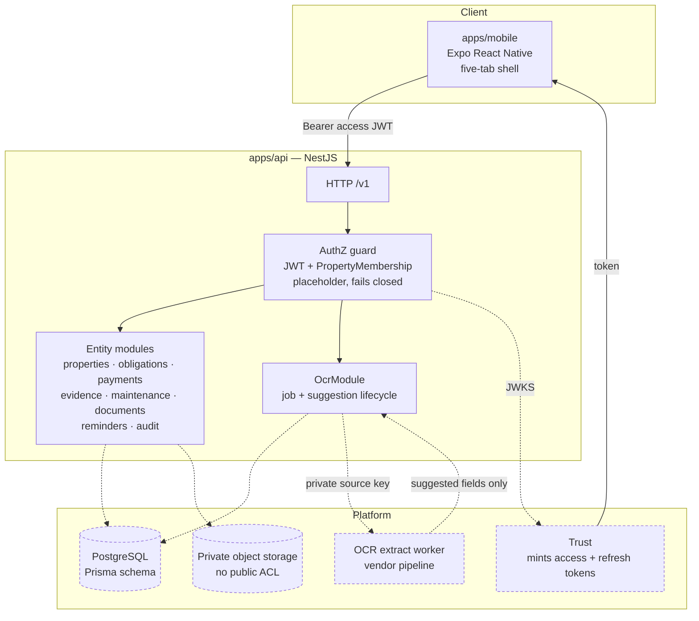
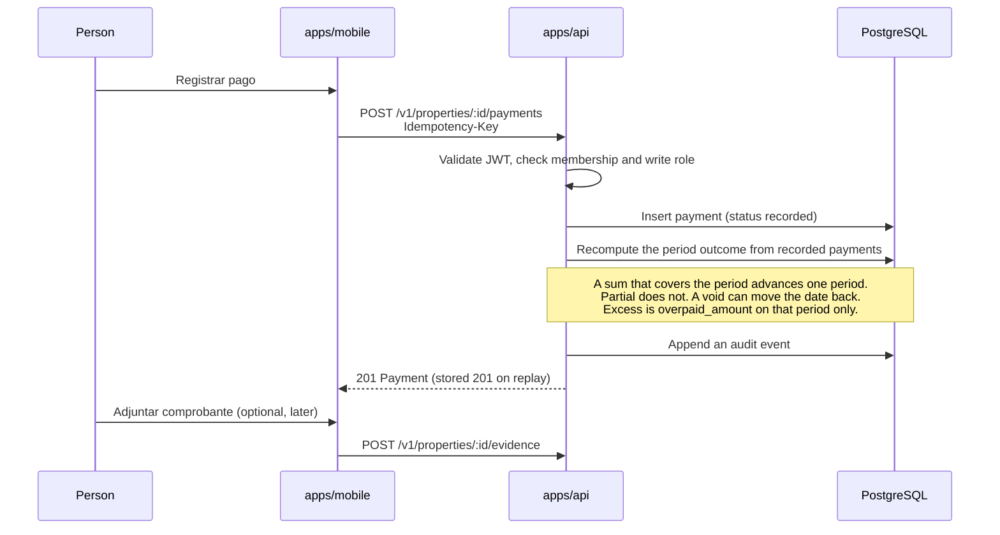
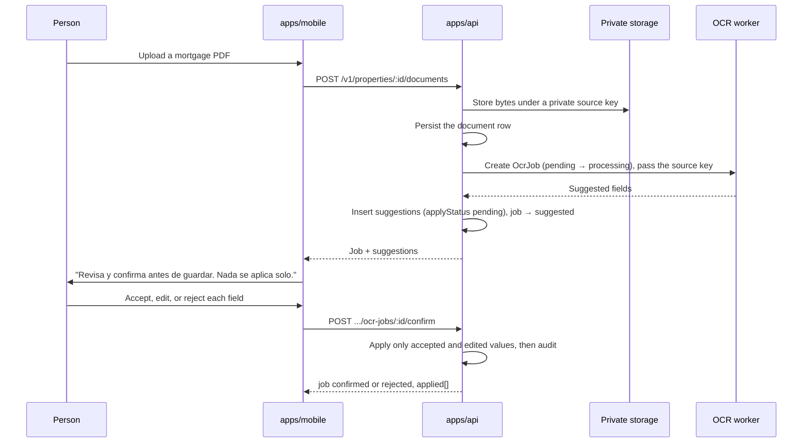

# Architecture

Two apps in one pnpm workspace, plus services that are specified and not built. Aligned to [Backend formal v0](https://docs.google.com/document/d/1iekHZp5lOq4qTzLhglFproL2JSeI7Uw1q4I817d40dE/edit).

## System

Dashed means specified, not wired in this scaffold.

## Apps

### apps/api — NestJS + TypeScript

One Nest module per entity group, matching the module table in the formal v0 doc. Today each module is a controller with the v0 route shape:

- Collection reads return `{ items: [], stub: true, module }`.
- Mutations and single-resource reads return **501** with the module name.
- OCR routes are in memory and stay **501** unless `OCR_STUB_ENABLED` is set. When it is on, they require an access token and a property membership.
- `GET /v1/health` checks the database with `SELECT 1` and is the only health route.

The modules present: `health`, `auth`, `users`, `home`, `properties`, `memberships`, `invites`, `obligations`, `payments`, `evidence`, `maintenance`, `documents`, `reminders`, `audit`, `ocr`. The stub maps **57** routes.

Not present yet, and named in formal v0: `StorageModule` (signed PUT and GET, delete on hard delete) and `RetentionModule` (the 30-day soft-to-hard delete job).

### apps/mobile — Expo React Native + TypeScript

A bottom-tab navigator with the five locked tabs and placeholder Spanish copy. No API client, no state management, no auth. The OCR review screen is noted on the Documentos tab and is not built.

## Boundaries

| Concern | Owner |
| :---- | :---- |
| Mint and refresh access tokens | Trust |
| Validate a Bearer access JWT | `apps/api` |
| Enforce `PropertyMembership` on every property-scoped route | `apps/api` |
| Store obligation, payment, and file metadata | `apps/api` + PostgreSQL |
| Hold file bytes | Private object storage |
| Extract fields from a document | OCR worker or vendor |
| Decide whether a suggestion applies | The person, through `POST .../confirm` |

The API never mints a token. The OCR vendor never writes an obligation or a payment row.

## Data flow: record a payment

No money moves at any step. The payment row says a person paid something elsewhere.

## Data flow: document upload and OCR

The obligation changes at the confirm step and nowhere earlier. See [OCR.md](OCR.md).

## Conventions

- Routes live under `/v1`, including `GET /v1/health`.
- Soft delete sets `deletedAt`. A retention job hard-deletes after 30 days and removes the object.
- A missing membership returns **404**, not 403, so the API does not leak which properties exist. A valid membership with the wrong role returns **403**. A viewer write, such as void, returns 403. A non-member and an unknown resource return 404.
- `Idempotency-Key` scopes to `(property_id, idempotency_key)`.
- Reminder rows are unique on (parent, `scheduled_for`, `channel`) via two partial indexes. Delivery idempotency is `(reminder_id, scheduled_for, user_id, channel)`.
- Audit events are append-only. A payment void is an audit event. Payments are not soft-deleted.
- `amount` and `expected_amount` are BIGINT centavos. The API wire format is a decimal string such as `"1234.50"` plus currency MXN, never a float and never centavos.
- Every Property response includes `timezone`, an IANA string defaulting to `America/Mexico_City`. The one-year `paidAt` back-date limit uses that timezone, not UTC.
- Email invites are `MembershipInvite` rows. Only an owner invites, by email, as member or viewer. Accept checks an unknown token or the wrong account as 404 before revealing token state. Trust still mints the session used to accept.

## Why this shape

A single API serving one client keeps the membership check in one place. OCR lives in its own module because its write path is the one place a vendor's output could leak into user data, and a separate module makes that boundary easy to review. Prisma is checked in ahead of any query so the entity contract is reviewable before persistence lands.

Open platform questions from formal v0: whether the API or Trust signs object URLs, and who owns the OCR worker. Invite behavior and the reminder key are locked in [EDGE_CASES.md](EDGE_CASES.md). The public product name there is DueRecord.
