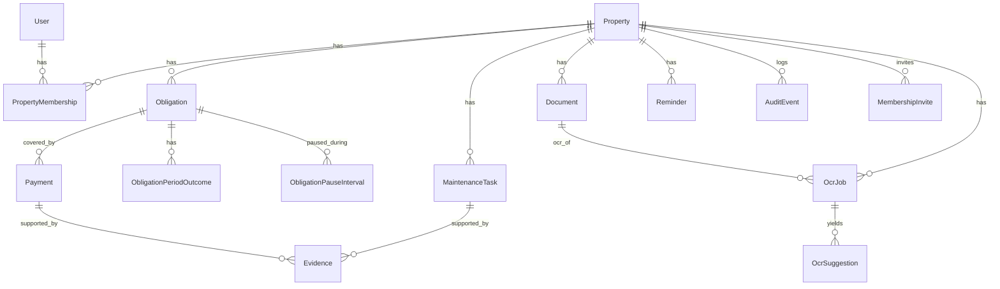

# Data model

Entities and key fields, from [Backend formal v0](https://docs.google.com/document/d/1iekHZp5lOq4qTzLhglFproL2JSeI7Uw1q4I817d40dE/edit) and [EDGE_CASES.md](EDGE_CASES.md). The public product name in that spec is DueRecord. The Prisma version is [`apps/api/prisma/schema.prisma`](../apps/api/prisma/schema.prisma). It is not migrated and no route reads it yet. Where this page and the edge-case spec disagree, the spec wins.

PostgreSQL. UUID primary keys, `timestamptz` timestamps, `snake_case` table and column names, soft delete through `deleted_at` where the table has it.

## Relationships

## User

A local row for a Trust subject, so other tables have something to reference. No password, no credential, no session secret.

| Field | Notes |
| :---- | :---- |
| `id` | uuid |
| `trust_sub` | Unique. The `sub` claim from the Trust JWT. |
| `email`, `display_name` | Denormalized for display. Trust is authoritative. |

Upsert on first sight of a subject is acceptable.

## Property

| Field | Notes |
| :---- | :---- |
| `name` | Required |
| `property_type` | `house` · `apartment` · `land` · `commercial` · `other` |
| `occupancy_status` | `owned` · `rented` · `family` · `investment` |
| `address_line`, `city`, `state`, `postal_code` | Optional |
| `country` | Defaults to `MX` |
| `timezone` | IANA name from the tz database. Defaults to `America/Mexico_City`. Due dates are calendar dates in this timezone. The column does not store an offset. An unknown name is rejected with 422. |
| `deleted_at` | Soft delete. Membership checks treat a soft-deleted property as absent, so the caller gets 404. |

## PropertyMembership

The authorization edge. Every property-scoped read and write passes through it.

| Field | Notes |
| :---- | :---- |
| `property_id`, `user_id` | Unique together |
| `role` | `owner` · `member` · `viewer`. Product may cut to owner and viewer. |
| `status` | `active` · `invited` · `revoked` |
| `deleted_at` | Revocation keeps the history |

## Obligation

The rule, not the event. What is owed, how often, and when next.

| Field | Notes |
| :---- | :---- |
| `category` | `predial` · `water` · `electricity` · `gas` · `internet` · `mantenimiento` · `mortgage` · `insurance` · `security` · `other`. English values, Spanish labels in the client. |
| `title` | Required, free text |
| `provider_name` | CFE, the bank, the HOA |
| `recurrence` | `monthly` · `bimonthly` · `quarterly` · `semiannual` · `annual` · `custom` · `irregular`. `irregular` is approximately one-time. |
| `due_day` | Integer 1–31. Required with `schedule_anchor` for every recurrence except `custom` and `irregular`. |
| `schedule_anchor` | Calendar date whose year and month are period index 0. The day used for each period is `due_day`, clamped to the month. |
| `next_due_date` | A date, not a timestamp. Recomputed from the anchor, not from the previous clamped date. |
| `expected_amount` | Integer centavos, nullable when the bill is variable |
| `currency` | `MXN` only |
| `reminder_offsets` | `integer[]`, defaults to `{7,1}` — days before the due date |
| `preferred_method` | Descriptive text. Not a stored payment instrument. |
| `is_active` | `false` is **paused**: no new periods or reminders |
| `deleted_at` | **Archived**: hidden from active lists, history kept |

Three distinct states, and keeping them distinct is a product lock:

| Intent | Mechanism |
| :---- | :---- |
| Skip this period | An `ObligationPeriodOutcome` row with outcome `not_applicable`. `next_due_date` advances one period, `is_active` stays true, `deleted_at` stays null. 409 when a non-voided payment exists, or when the period is already `paid` or `not_applicable`. |
| Pause the obligation | `is_active = false` and one open `ObligationPauseInterval`. No overdue row, no new period, no reminder sent. |
| Archive the obligation | `deleted_at = now()` and pause. Hidden from default lists. New payments and N/A return 409. Unarchive clears `deleted_at` and leaves `is_active` false. |

## Payment

An event that settles some or all of an obligation period. A record of something that already happened outside the app.

| Field | Notes |
| :---- | :---- |
| `obligation_id`, `property_id`, `period_due_date` | Required. The period the payment applies to. |
| `recorded_by_user_id` | Who entered it |
| `amount` | Integer centavos, greater than zero. A non-positive or non-integer amount returns 422. |
| `currency` | `MXN` only |
| `paid_at` | When the person says they paid. Later than now plus 24 hours, or earlier than now minus one calendar year, returns 422. |
| `method` | Free text: "SPEI", "efectivo", "tarjeta". Descriptive only. |
| `reference` | The folio |
| `status` | `recorded` · `voided`. This is the stored status. The client labels `voided` as Anulado. |
| `idempotency_key` | Unique with `property_id` for the create. |
| `voided_at`, `voided_by`, `void_reason` | Set together by the void. `void_reason` is 1–500 characters after trim. All three are null while status is `recorded`. |

There is no `deleted_at` on this table. A void keeps the row, the audit event, and the evidence.

No card token, no account number, no bank identifier, no clearing state, and no credit balance. Nothing in this table instructs a system to move funds. `overpaid_amount` lives on the period, not here.

`upcoming`, `due_today`, `due_soon`, `overdue`, `paid`, `partial`, and `not_applicable` are **computed** cycle statuses for a list response. They are never stored in `status`.

## ObligationPeriodOutcome

One row per `(obligation_id, period_due_date)`.

| Field | Notes |
| :---- | :---- |
| `period_due_date` | The period key, with `obligation_id` |
| `outcome` | `paid` · `partial` · `not_applicable` |
| `payment_id` | Nullable. When set, the latest non-voided payment for the outcome. The full ledger stays in `payments`. |
| `overpaid_amount` | Integer centavos, default 0. Excess of the non-voided sum over `expected_amount` on this period only. Not a credit for the next period. 0 when the sum does not exceed the expected amount, and 0 when `expected_amount` is null. |

Rules:

- `paid` and `partial` are reconciled from recorded, non-voided payments. A client does not post them. A sum of 0 removes the outcome row. The period then reads as open or overdue from the date, and those two words are not stored.
- `not_applicable` must have `payment_id` null. It creates no payment, advances `next_due_date` one period, and leaves `is_active` true. It returns 409 when a non-voided payment exists or the period is already `paid` or `not_applicable`.
- `partial` does **not** advance `next_due_date`. Reaching the expected amount sets `paid` and advances exactly one period from the anchor.
- A void recomputes the same fields and can move `next_due_date` back to the earliest candidate that is not settled.
- Reconciliation and date advancement happen in one transaction and append an audit event.

## ObligationPauseInterval

One row per pause. `paused_on` and `resumed_on` are property-timezone dates. `resumed_on` is null while the pause is open. `last_scheduled_due_date` is `next_due_date` at the moment the pause started. Dates inside the interval and after `last_scheduled_due_date` are never given an outcome row. Payments remain allowed on dates on or before `last_scheduled_due_date`.

## MembershipInvite

An owner invites by email. `role` is `member` or `viewer`. `token_hash` is the lowercase hex SHA-256 of a raw token that the create and resend responses return once. `expires_at` is `sent_at` plus 7 days. `used_at` and `revoked_at` are null until accept or revoke. Expired, revoked, and used tokens fail accept with 410. An email that already has an active membership fails the invite with 409.

## Evidence

An optional private file supporting a payment or a maintenance task.

| Field | Notes |
| :---- | :---- |
| `storage_key` | Unique. Private object key on the row. The client receives a `fileId` only and never this key. |
| `type` | `photo` · `screenshot` · `pdf` |
| `content_type` | Allowlist: `image/jpeg`, `image/png`, `application/pdf` |
| `byte_size` | Greater than zero, at most 15,728,640 (15 MiB) |
| `payment_id`, `maintenance_task_id` | Exactly one is set |
| `idempotency_key` | Unique with `property_id` |

Key convention: `properties/{propertyId}/evidence/{evidenceId}/{uuid}`.

Evidence is optional on a payment. A payment never requires an evidence row.

## MaintenanceTask

`title`, `description`, `status` (`open` · `in_progress` · `done` · `cancelled`), `due_on`, `deleted_at`. Light on purpose for the MVP.

## Document

A private file on a property: a deed, a mortgage, a policy, a receipt.

| Field | Notes |
| :---- | :---- |
| `title` | Required |
| `storage_key` | Unique and private |
| `content_type`, `byte_size` | Same allowlist and cap as evidence |

Key convention: `properties/{propertyId}/documents/{documentId}/{uuid}`.

A document upload is the trigger for OCR, mortgages and deeds first.

## Reminder

| Field | Notes |
| :---- | :---- |
| `obligation_id`, `maintenance_task_id` | Exactly one is set |
| `period_due_date` | The period the reminder belongs to, when the parent is an obligation |
| `scheduled_for` | `timestamptz`. 09:00 in the property timezone, stored in UTC |
| `channel` | `email` · `push` · `in_app` |
| `status` | `pending` · `sent` · `cancelled` · `failed` |
| `sent_at` | Set when delivered |

Uniqueness is two partial unique indexes, not `(id, scheduled_for)`:

- `reminders_obligation_id_scheduled_for_channel_key` on `(obligation_id, scheduled_for, channel)` WHERE `obligation_id IS NOT NULL`
- `reminders_maintenance_task_id_scheduled_for_channel_key` on `(maintenance_task_id, scheduled_for, channel)` WHERE `maintenance_task_id IS NOT NULL`

Prisma cannot declare the `WHERE` clause. The statements are in [`apps/api/prisma/sql/checks.sql`](../apps/api/prisma/sql/checks.sql). Two channels at the same `scheduled_for` are two rows.

Default offsets are `[7, 1]`. Generation also inserts offset 0 as `in_app` only. Duplicate offsets are removed. Generation upserts. A `scheduled_for` that is already past is skipped. Changing offsets or the due date drops `pending` rows and leaves `sent` rows.

## NotificationDelivery

Unique on `(reminder_id, scheduled_for, user_id, channel)`. A worker retry does not insert a second delivery.

## AuditEvent

Append-only. No `updated_at`, no `deleted_at`, never deleted in the MVP.

| Field | Notes |
| :---- | :---- |
| `action` | `obligation.update`, `payment.void`, `membership.revoke`, `ocr.confirm`, … |
| `entity_type`, `entity_id` | What changed |
| `before_state`, `after_state`, `metadata` | `jsonb` |
| `actor_user_id` | Who did it |

This is the record for things with no undo, including a not-applicable period.

## OcrJob

One extract run for a document.

| Field | Notes |
| :---- | :---- |
| `document_id` | Required |
| `evidence_id` | Nullable, reserved for evidence OCR later |
| `status` | `pending` · `processing` · `suggested` · `confirmed` · `rejected` · `failed` |
| `storage_key` | The private object the extract read |
| `vendor` | Opaque pipeline identifier |
| `error` | Set with status `failed` |

## OcrSuggestion

One suggested field, waiting for a decision.

| Field | Notes |
| :---- | :---- |
| `ocr_job_id` | Cascades on job delete |
| `target_entity_type` | `obligation` · `payment` · `property` · `document_meta` |
| `target_entity_id` | Nullable until the person binds it or confirms |
| `field_path` | `expectedAmount`, `nextDueDate`, `providerName`, … |
| `suggested_value` | `jsonb` |
| `confidence` | `numeric(5,4)`, nullable when the vendor omits it |
| `user_edited_value` | `jsonb`, set when the person edits before accepting |
| `apply_status` | `pending` · `accepted` · `rejected` |

A suggestion row is a proposal. It is not a write. The target entity changes only when application code handles the confirm request. See [OCR.md](OCR.md) and [ADR 0002](adr/0002-ocr-suggest-then-confirm.md).

## IdempotencyRecord

A generic store for mutating POSTs that do not have their own unique key. Payments and evidence use their table-local `(property_id, idempotency_key)` constraint instead. Unique on `(property_id, route_key, idempotency_key)`.

## Retention

| Phase | Behavior |
| :---- | :---- |
| Soft delete | Set `deleted_at`, exclude from default queries. A membership check treats a soft-deleted property or membership as absent, so the caller sees 404. Payments are voided instead, and a void does not set a delete timestamp. |
| Retention | A daily job hard-deletes rows with `deleted_at` older than 30 days. |
| Storage | A hard delete of evidence or a document removes the object at `storage_key`. |
| Audit | Both deletes append an audit event. Audit rows are never deleted. |

## Constraints the migration must add

Prisma cannot express these. Put them in the first migration as SQL:

The statements are in [`apps/api/prisma/sql/checks.sql`](../apps/api/prisma/sql/checks.sql). They include:

- `payments.amount > 0` and `payments.currency = 'MXN'`
- Void columns are all set exactly when `status = 'voided'`, and `void_reason` trims to 1–500 characters
- `obligations.due_day` is null or 1–31, and it is paired with `schedule_anchor`
- `overpaid_amount >= 0`
- `not_applicable` implies `payment_id` is null
- Evidence and reminder parent XOR, content-type allowlist, and the 15 MiB cap
- The two reminder partial unique indexes named above
- Invite `role` is `member` or `viewer`
- `CREATE EXTENSION IF NOT EXISTS "pgcrypto"`
