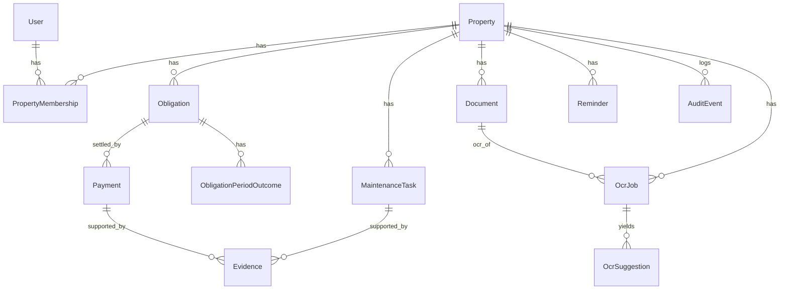

# Data model

Entities and key fields, from [Backend formal v0](https://docs.google.com/document/d/1iekHZp5lOq4qTzLhglFproL2JSeI7Uw1q4I817d40dE/edit). The Prisma version is [`apps/api/prisma/schema.prisma`](../apps/api/prisma/schema.prisma). It is not migrated and no route reads it yet.

PostgreSQL. UUID primary keys, `timestamptz` timestamps, `snake_case` table and column names, soft delete through `deleted_at` where the table has it.

## Relationships

## User

A local row for a Trust subject, so other tables have something to reference. No password, no credential, no session secret.

| Field | Notes |
| :---- | :---- |
| `id` | uuid |
| `trust_sub` | Unique. The `sub` claim from the Trust JWT. |
| `email`, `display_name` | Denormalized for display. Trust is authoritative. |

Upsert on first sight of a subject is acceptable.

## Property

| Field | Notes |
| :---- | :---- |
| `name` | Required |
| `property_type` | `house` · `apartment` · `land` · `commercial` · `other` |
| `occupancy_status` | `owned` · `rented` · `family` · `investment` |
| `address_line`, `city`, `state`, `postal_code` | Optional |
| `country` | Defaults to `MX` |
| `timezone` | Defaults to `America/Mexico_City`. Due dates are local dates. |
| `deleted_at` | Soft delete. Membership checks treat a soft-deleted property as absent, so the caller gets 404. |

## PropertyMembership

The authorization edge. Every property-scoped read and write passes through it.

| Field | Notes |
| :---- | :---- |
| `property_id`, `user_id` | Unique together |
| `role` | `owner` · `member` · `viewer`. Product may cut to owner and viewer. |
| `status` | `active` · `invited` · `revoked` |
| `deleted_at` | Revocation keeps the history |

## Obligation

The rule, not the event. What is owed, how often, and when next.

| Field | Notes |
| :---- | :---- |
| `category` | `predial` · `water` · `electricity` · `gas` · `internet` · `mantenimiento` · `mortgage` · `insurance` · `security` · `other`. English values, Spanish labels in the client. |
| `title` | Required, free text |
| `provider_name` | CFE, the bank, the HOA |
| `recurrence` | `monthly` · `bimonthly` · `quarterly` · `semiannual` · `annual` · `custom` · `irregular`. `irregular` is approximately one-time. |
| `next_due_date` | A date, not a timestamp |
| `expected_amount` | `numeric(14,2)`, nullable for variable bills |
| `currency` | Defaults to `MXN` |
| `reminder_offsets` | `integer[]`, defaults to `{7,1}` — days before the due date |
| `preferred_method` | Descriptive text. Not a stored payment instrument. |
| `is_active` | `false` is **paused**: no new periods or reminders |
| `deleted_at` | **Archived**: hidden from active lists, history kept |

Three distinct states, and keeping them distinct is a product lock:

| Intent | Mechanism |
| :---- | :---- |
| Skip this period | An `ObligationPeriodOutcome` row with outcome `not_applicable`. `next_due_date` advances, `is_active` stays true. |
| Pause the obligation | `is_active = false`. The schedule does not advance. |
| Archive the obligation | `deleted_at = now()`. Excluded from default lists. |

## Payment

An event that settles some or all of an obligation period. A record of something that already happened outside the app.

| Field | Notes |
| :---- | :---- |
| `obligation_id`, `property_id` | Required |
| `recorded_by_user_id` | Who entered it |
| `amount` | `numeric(14,2)`, must be greater than zero |
| `currency` | Defaults to `MXN` |
| `paid_at` | When the person says they paid |
| `method` | Free text: "SPEI", "efectivo", "tarjeta". Descriptive only. |
| `reference` | The folio |
| `status` | `recorded` · `voided`. This is the stored status. |
| `idempotency_key` | Unique with `property_id` |
| `deleted_at` | Soft delete |

No card token, no account number, no bank identifier, no clearing state. Nothing in this table instructs a system to move funds.

`upcoming`, `due_today`, `due_soon`, `overdue`, `paid`, `partial`, and `not_applicable` are **computed** cycle statuses for a list response. They are never stored in `status`.

## ObligationPeriodOutcome

One row per `(obligation_id, period_due_date)`.

| Field | Notes |
| :---- | :---- |
| `period_due_date` | The period key, with `obligation_id` |
| `outcome` | `paid` · `partial` · `not_applicable` |
| `payment_id` | Nullable. When set, the primary or latest payment for the outcome. The full ledger stays in `payments`. |

Rules:

- `paid` and `partial` are reconciled from recorded, non-voided payments. A client does not post them.
- `not_applicable` must have `payment_id = NULL`. It creates no payment, advances `next_due_date`, and leaves `is_active = true`.
- `partial` does **not** advance `next_due_date` until the period is fully paid or marked not applicable.
- Reconciliation and date advancement happen in one transaction and append an audit event.

## Evidence

An optional private file supporting a payment or a maintenance task.

| Field | Notes |
| :---- | :---- |
| `storage_key` | Unique. The private object key. The API may expose it as `fileId`. **Never a public URL.** |
| `type` | `photo` · `screenshot` · `pdf` |
| `content_type` | Allowlist: `image/jpeg`, `image/png`, `application/pdf` |
| `byte_size` | Greater than zero, at most 15,728,640 (15 MiB) |
| `payment_id`, `maintenance_task_id` | Exactly one is set |
| `idempotency_key` | Unique with `property_id` |

Key convention: `properties/{propertyId}/evidence/{evidenceId}/{uuid}`.

Evidence is optional on a payment. A payment never requires an evidence row.

## MaintenanceTask

`title`, `description`, `status` (`open` · `in_progress` · `done` · `cancelled`), `due_on`, `deleted_at`. Light on purpose for the MVP.

## Document

A private file on a property: a deed, a mortgage, a policy, a receipt.

| Field | Notes |
| :---- | :---- |
| `title` | Required |
| `storage_key` | Unique and private |
| `content_type`, `byte_size` | Same allowlist and cap as evidence |

Key convention: `properties/{propertyId}/documents/{documentId}/{uuid}`.

A document upload is the trigger for OCR, mortgages and deeds first.

## Reminder

| Field | Notes |
| :---- | :---- |
| `obligation_id`, `maintenance_task_id` | Either, both nullable |
| `scheduled_for` | `timestamptz` |
| `channel` | `email` · `push` · `in_app` |
| `status` | `pending` · `sent` · `cancelled` · `failed` |
| `sent_at` | Set when delivered |

`(id, scheduled_for)` is unique so a worker can retry a fire safely. Reminder rows come from the obligation's `reminder_offsets`, which default to 7 and 1 days before the due date.

## AuditEvent

Append-only. No `updated_at`, no `deleted_at`, never deleted in the MVP.

| Field | Notes |
| :---- | :---- |
| `action` | `obligation.update`, `payment.void`, `membership.revoke`, `ocr.confirm`, … |
| `entity_type`, `entity_id` | What changed |
| `before_state`, `after_state`, `metadata` | `jsonb` |
| `actor_user_id` | Who did it |

This is the record for things with no undo, including a not-applicable period.

## OcrJob

One extract run for a document.

| Field | Notes |
| :---- | :---- |
| `document_id` | Required |
| `evidence_id` | Nullable, reserved for evidence OCR later |
| `status` | `pending` · `processing` · `suggested` · `confirmed` · `rejected` · `failed` |
| `storage_key` | The private object the extract read |
| `vendor` | Opaque pipeline identifier |
| `error` | Set with status `failed` |

## OcrSuggestion

One suggested field, waiting for a decision.

| Field | Notes |
| :---- | :---- |
| `ocr_job_id` | Cascades on job delete |
| `target_entity_type` | `obligation` · `payment` · `property` · `document_meta` |
| `target_entity_id` | Nullable until the person binds it or confirms |
| `field_path` | `expectedAmount`, `nextDueDate`, `providerName`, … |
| `suggested_value` | `jsonb` |
| `confidence` | `numeric(5,4)`, nullable when the vendor omits it |
| `user_edited_value` | `jsonb`, set when the person edits before accepting |
| `apply_status` | `pending` · `accepted` · `rejected` |

A suggestion row is a proposal. It is not a write. The target entity changes only when application code handles the confirm request. See [OCR.md](OCR.md) and [ADR 0002](adr/0002-ocr-suggest-then-confirm.md).

## IdempotencyRecord

A generic store for mutating POSTs that do not have their own unique key. Payments and evidence use their table-local `(property_id, idempotency_key)` constraint instead. Unique on `(property_id, route_key, idempotency_key)`.

## Retention

| Phase | Behavior |
| :---- | :---- |
| Soft delete | Set `deleted_at`, exclude from default queries. A membership check treats a soft-deleted property or membership as absent, so the caller sees 404. |
| Retention | A daily job hard-deletes rows with `deleted_at` older than 30 days. |
| Storage | A hard delete of evidence or a document removes the object at `storage_key`. |
| Audit | Both deletes append an audit event. Audit rows are never deleted. |

## Constraints the migration must add

Prisma cannot express these. Put them in the first migration as SQL:

- `payments.amount > 0`
- `evidence`: exactly one of `payment_id` or `maintenance_task_id` is set
- `evidence.content_type` and `documents.content_type` in the allowlist
- `byte_size > 0 AND byte_size <= 15728640` on both file tables
- `obligation_period_outcomes`: `outcome <> 'not_applicable' OR payment_id IS NULL`
- `reminders`: unique `(id, scheduled_for)`
- Partial indexes with `WHERE deleted_at IS NULL`, and the active-membership partial indexes
- `CREATE EXTENSION IF NOT EXISTS "pgcrypto"` if you want `gen_random_uuid()` defaults in SQL rather than Prisma-side UUIDs
