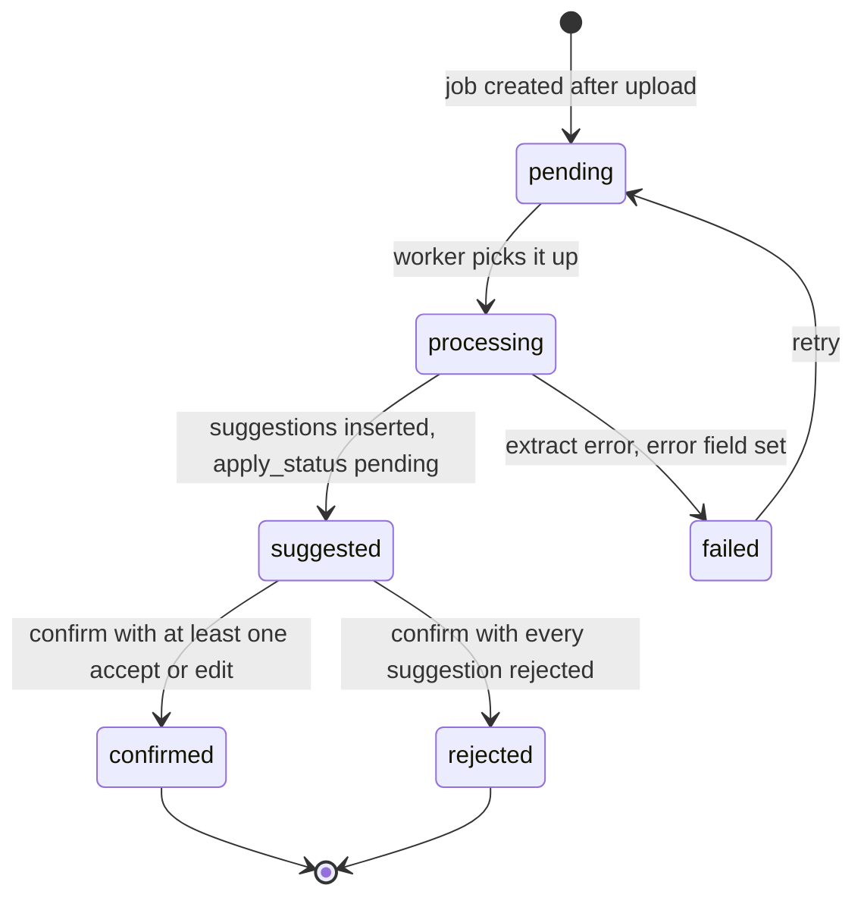

# OCR

OCR is in the MVP as of the 30 Sep 2026 amendment to the product brief. It reads an uploaded document and **suggests** fields. A person **confirms** before anything is written.

The one rule that governs this whole feature: **reaching `suggested` writes nothing.** An obligation, a payment, a property, or a document row changes only inside the handler for `POST .../ocr-jobs/:ocrJobId/confirm`. There is no code path that applies a suggestion on job completion, on a vendor callback, on a timer, or on a high confidence score. See [ADR 0002](adr/0002-ocr-suggest-then-confirm.md).

When confirm eventually persists a money field, the database stores integer centavos. The API wire value is a decimal string such as `"18450.00"` plus currency MXN, never a float. The stub does not write the field.

## Trigger

After a document finishes uploading to private storage. Priority is mortgages, deeds, and related property documents, which carry the amounts and dates worth extracting. Evidence OCR may opt in later through the nullable `evidence_id` on the job.

The API may enqueue the job automatically after the upload, or wait for the client to post to the ocr-jobs route. Either way the job starts at `pending`.

## States



Job: `pending` → `processing` → `suggested` → `confirmed` | `rejected` | `failed`.
Suggestion: `pending` → `accepted` | `rejected`.

`suggested` is a waiting state. It means the system has an opinion and no permission. Nothing downstream of it happens without a person.

## Sequence

| Step | Who | What |
| :---- | :---- | :---- |
| 1 | Client | Uploads the document, multipart or pre-signed PUT then complete |
| 2 | API | Persists the document row, then enqueues a job or waits for the client to ask |
| 3 | API | Creates the `OcrJob` (`pending` → `processing`) and passes the private source key to the extract pipeline |
| 4 | Worker, then API | Extract returns fields. The API inserts `OcrSuggestion` rows and moves the job to `suggested`, or to `failed` with an `error`. |
| 5 | Client | Reads the job and its suggestions, renders the review sheet |
| 6 | Client | Posts a decision per suggestion: accept, reject, or edit |
| 7 | API | Applies only the accepted and edited values, in one transaction, sets each `apply_status`, moves the job to `confirmed` or `rejected`, and appends an audit event |

## Suggestions

Each row is a proposal:

| Field | Meaning |
| :---- | :---- |
| `target_entity_type` | `obligation` · `payment` · `property` · `document_meta` |
| `target_entity_id` | Nullable until the person binds a target or confirms |
| `field_path` | `expectedAmount`, `nextDueDate`, `providerName`, … |
| `suggested_value` | The extracted value as JSON |
| `confidence` | From the vendor when provided, nullable otherwise |
| `user_edited_value` | What the person typed instead, when they edited |
| `apply_status` | `pending` → `accepted` \| `rejected` |

Confidence is display information for the review sheet. It is not an authorization to apply. There is no threshold above which a field applies by itself.

## Confirm

```text
POST /v1/properties/:propertyId/ocr-jobs/:ocrJobId/confirm
{
  "decisions": [
    { "suggestionId": "...", "action": "accept", "targetEntityId": "..." },
    { "suggestionId": "...", "action": "edit", "editedValue": "19000.00",
      "targetEntityId": "..." },
    { "suggestionId": "...", "action": "reject" }
  ]
}
```

Rules:

- **Accept** applies the suggested value only when the saved field is null. **Edit** applies `editedValue` when the saved field is null. Accept or edit of a saved non-null value returns 409 `field_already_set` and does not mark the suggestion accepted. **Replace** overwrites a saved value and writes the replace audit. **Reject** writes nothing and sets `apply_status = 'rejected'`.
- Confirm validates every decision first, then writes them together. A failed write rolls back the fields already written in that confirm. `persisted` is true only when the writes commit.
- A bulk `acceptAll` or `replaceAll` shape returns 422 `bulk_accept_rejected`, and `clientPriorValue` on the body or a decision returns 422 `client_prior_value_rejected`. Unsaved typed text is not stored. An unsaved Reemplazar writes no audit row. Only a saved field is audited. A payment field or a property title is 422 `target_not_writable` until that write exists. OCR 4xx bodies carry a stable `error` code, listed in [API.md](API.md). A 404 is always `not_found`.
- A suggestion needs a `target_entity_id`, from the row or from the decision, before it can be accepted, replaced, or edited. Missing is 422. A non-UUID is 400. A bound target cannot be changed: the same property is 422, and a foreign or forged id is 404. A missing, wrong-type, or soft-deleted target is 404. A voided payment is 422. Confirm does not create an entity.
- All-or-nothing for the accepted set. A partial failure returns 409 or 422 rather than applying some fields and silently dropping others.
- Every decision rejected means the job ends `rejected`, no entity field changes, and the document stays stored.
- Each applied field gets an audit event. Accept and edit use `{ source: "ocr", ocrJobId, suggestionId, field, actorUserId, confidence, edited, previousValue: null, newValue }`. `edited` is false for accept and true for edit. Reject writes no applied-field audit. Raw document text is not stored in the audit. Replace keeps its own audit shape.

The response contains the job, the updated suggestions, and `applied`, which lists every field actually written with its entity and field path. That list is the auditable answer to "what did OCR change".

## What the stub does

`apps/api/src/ocr/ocr.service.ts` is in-memory and makes no model call. The point is to pin the contract and the rule, not to extract anything.

| Behavior | Detail |
| :---- | :---- |
| Storage | A `Map` in the Nest process. Jobs vanish on restart. `OCR_JOBS_MAX` (default 50) caps one property. `OCR_JOBS_GLOBAL_MAX` (default 1000) caps every property together. TTL `OCR_JOB_TTL_MS` (default 15 minutes). Expired jobs may be dropped. An unexpired suggested job is never evicted; a full property or a full global ceiling returns 429. A suggested job with no suggestions does not take a slot. |
| Flag | Off unless `OCR_STUB_ENABLED` is `1`, `true`, `yes`, or `on`. Off returns 501 before path or body parsing. |
| Auth | Access token first (401), then property membership. Unknown property, document, or membership is 404. A viewer can read and cannot enqueue or confirm (403). |
| Extract | `enqueue()` runs through `processing` synchronously and returns `suggested` with `vendor: "stub"` |
| Suggestions | Four fixed rows: obligation `expectedAmount` (`"18450.00"`), `nextDueDate`, and `providerName`, plus document `title`. Only the document row is pre-bound, and only to the source document. `band` uses the configured thresholds, default alta 0.90 and media 0.80. `revisa` is below media, a missing or non-numeric score, a score outside 0..1, or any `lowConfidence` flag, including an ambiguous amount such as `1,234` at a high score. The job returns those `confidenceBands`. A failed extract returns `errorCode: "extract_failed"` and not the extractor's text. |
| Reuse | Posting again for the same document while a job is open and unexpired returns 200 and the existing job instead of creating a second one |
| Decisions | Whitelisted keys only. Every suggestion needs an explicit accept, replace, reject, or edit. An unknown suggestion id is 404 and the body does not repeat that id. A missing one is 422. A duplicate is 400. An edit with no `editedValue` is 400. `acceptAll`, `replaceAll`, and `clientPriorValue` are 422. An unbound accept, replace, or edit needs a UUID `targetEntityId` (missing 422, non-UUID 400). The id must exist in the same property, match the suggestion type, and not be soft-deleted, or the response is 404. A voided payment is 422. A payment field or a property title is 422 `target_not_writable`. A bound target cannot be changed. |
| `document_meta` | Applies only to the job's source document. The row is pre-bound, so another document in the same property is 422 and a foreign document is 404. The same rule applies to any already-bound target. |
| `editedValue` | Canonical for the field: a peso string with at most two decimals, an ISO date inside the property-timezone window (today minus 1 year through today plus 5 years) and inside the 1990–2100 sanity bound, or NFC text of at most 300 characters for a title. Single-line text rejects every C0 character, including tab, CR, and LF, plus U+2028 and U+2029, C1, every bidi control (U+061C, U+200E, U+200F, U+202A–U+202E, U+2066–U+2069), zero-width characters, U+00AD, U+180E, U+2061–U+2064, and lone surrogates. `notes` may contain LF, U+2028, and U+2029, and is at most 2000 UTF-16 code units after CR and CRLF are stored as LF (1000 emoji pass, 1001 fail). A notes value that is only CR is whitespace and is 422. A title rejects LF, CR, U+2028, and U+2029. A bad value is 422 and the body includes `suggestionId` and `field`. Unknown `fieldPath` and prototype keys are 400. The JSON body limit is 32 KB. |
| Accept with no target | 422, and every suggestion stays `pending` |
| Confirm twice, or confirm when the job is not `suggested` | 409 |
| Expired job | 410. It is not confirmed. |
| Applied | `persisted` is true only when the confirm's saves commit. A confirm with no `saveValue` writes stays `persisted: false`. `storageKey` is absent. |

The private source key, when one is built, is `{env}/documents/{uuid}` from `OBJECT_STORAGE_ENV` (`staging` or `prod`). It has no property id. It is not a URL, and it is not a field on any OCR response. Tests walk success and error bodies for `storageKey`, `storage_key`, and a raw `properties/...` bucket path.

### Tests that hold the rule

`apps/api/src/ocr/ocr.service.spec.ts`:

- A new job stops at `suggested` with every suggestion `pending`
- An open job is reused for the same document
- Rejecting everything ends the job `rejected` with an empty `applied` list
- Accepting an unbound obligation field is 422 and leaves every suggestion `pending`
- Accept and edit change `apply_status` only through `confirm`, and `persisted` is `false`
- The service exposes no `applyToObligation` or `createPayment` method

Breaking the suggest-then-confirm rule should break a test. If you change the apply path, change these first and explain why.

## What this is not

- Not a silent auto-fill. No confidence threshold, no "apply if the field is empty", no apply on a vendor callback.
- Not an overwrite of an existing obligation or payment field without a person choosing it.
- Not a complete legal OCR suite for every municipio.
- Not a path for the vendor to write user data. The vendor returns suggestions; the API decides they are suggestions.
- Not a way to move money. OCR can suggest an amount on an obligation. It cannot pay it.

## Next

The client review sheet (D-OCR in [UX.md](UX.md)) and the real worker. When persistence lands, the confirm handler is the place to be careful: one transaction, one audit entry per applied field, and no write outside that handler.
