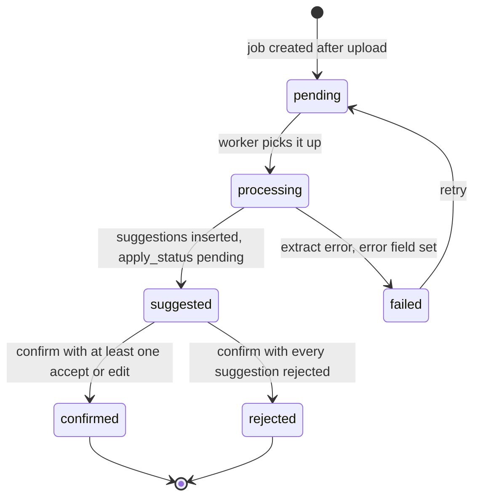

# OCR

OCR is in the MVP as of the 30 Sep 2026 amendment to the product brief. It reads an uploaded document and **suggests** fields. A person **confirms** before anything is written.

The one rule that governs this whole feature: **reaching `suggested` writes nothing.** An obligation, a payment, a property, or a document row changes only inside the handler for `POST .../ocr-jobs/:ocrJobId/confirm`. There is no code path that applies a suggestion on job completion, on a vendor callback, on a timer, or on a high confidence score. See [ADR 0002](adr/0002-ocr-suggest-then-confirm.md).

## Trigger

After a document finishes uploading to private storage. Priority is mortgages, deeds, and related property documents, which carry the amounts and dates worth extracting. Evidence OCR may opt in later through the nullable `evidence_id` on the job.

The API may enqueue the job automatically after the upload, or wait for the client to post to the ocr-jobs route. Either way the job starts at `pending`.

## States



Job: `pending` → `processing` → `suggested` → `confirmed` | `rejected` | `failed`.
Suggestion: `pending` → `accepted` | `rejected`.

`suggested` is a waiting state. It means the system has an opinion and no permission. Nothing downstream of it happens without a person.

## Sequence

| Step | Who | What |
| :---- | :---- | :---- |
| 1 | Client | Uploads the document, multipart or pre-signed PUT then complete |
| 2 | API | Persists the document row, then enqueues a job or waits for the client to ask |
| 3 | API | Creates the `OcrJob` (`pending` → `processing`) and passes the private `storage_key` to the extract pipeline |
| 4 | Worker, then API | Extract returns fields. The API inserts `OcrSuggestion` rows and moves the job to `suggested`, or to `failed` with an `error`. |
| 5 | Client | Reads the job and its suggestions, renders the review sheet |
| 6 | Client | Posts a decision per suggestion: accept, reject, or edit |
| 7 | API | Applies only the accepted and edited values, in one transaction, sets each `apply_status`, moves the job to `confirmed` or `rejected`, and appends an audit event |

## Suggestions

Each row is a proposal:

| Field | Meaning |
| :---- | :---- |
| `target_entity_type` | `obligation` · `payment` · `property` · `document_meta` |
| `target_entity_id` | Nullable until the person binds a target or confirms |
| `field_path` | `expectedAmount`, `nextDueDate`, `providerName`, … |
| `suggested_value` | The extracted value as JSON |
| `confidence` | From the vendor when provided, nullable otherwise |
| `user_edited_value` | What the person typed instead, when they edited |
| `apply_status` | `pending` → `accepted` \| `rejected` |

Confidence is display information for the review sheet. It is not an authorization to apply. There is no threshold above which a field applies by itself.

## Confirm

```text
POST /v1/properties/:propertyId/ocr-jobs/:ocrJobId/confirm
{
  "decisions": [
    { "suggestionId": "...", "action": "accept", "targetEntityId": "..." },
    { "suggestionId": "...", "action": "edit", "editedValue": { "amount": "19000.00", "currency": "MXN" },
      "targetEntityId": "..." },
    { "suggestionId": "...", "action": "reject" }
  ]
}
```

Rules:

- **Accept** applies the suggested value. **Edit** applies `editedValue` and stores it in `user_edited_value`. **Reject** writes nothing and sets `apply_status = 'rejected'`.
- A suggestion needs a `target_entity_id`, from the row or from the decision, before it can be accepted.
- All-or-nothing for the accepted set. A partial failure returns 409 or 422 rather than applying some fields and silently dropping others.
- Every decision rejected means the job ends `rejected`, no entity field changes, and the document stays stored.
- Each applied field gets an audit event, or one batched event naming them.

The response contains the job, the updated suggestions, and `applied`, which lists every field actually written with its entity and field path. That list is the auditable answer to "what did OCR change".

## What the stub does

`apps/api/src/ocr/ocr.service.ts` is in-memory and makes no model call. The point is to pin the contract and the rule, not to extract anything.

| Behavior | Detail |
| :---- | :---- |
| Storage | A `Map` in the Nest process. Jobs vanish on restart. |
| Extract | `enqueue()` runs through `processing` synchronously and returns `suggested` with `vendor: "stub"` |
| Suggestions | Four fixed rows: obligation `expectedAmount`, `nextDueDate`, and `providerName`, plus document `title`. Only the document row is pre-bound to a target. |
| Reuse | Posting again for the same document while a job is open returns 200 and the existing job instead of creating a second one |
| Decisions | Every suggestion needs an explicit accept, reject, or edit. A missing one is 422. A duplicate is 400. An edit with no `editedValue` is 400. |
| Accept with no target | 422, and every suggestion stays `pending` |
| Confirm twice | 409, because the job is no longer `suggested` |
| Applied | `persisted: false` in the response, because nothing was written anywhere |

The `storage_key` is a private key shape, never a URL, and a test asserts that.

### Tests that hold the rule

`apps/api/src/ocr/ocr.service.spec.ts`:

- A new job stops at `suggested` with every suggestion `pending`
- An open job is reused for the same document
- Rejecting everything ends the job `rejected` with an empty `applied` list
- Accepting an unbound obligation field is 422 and leaves every suggestion `pending`
- Accept and edit change `apply_status` only through `confirm`, and `persisted` is `false`
- The service exposes no `applyToObligation` or `createPayment` method

Breaking the suggest-then-confirm rule should break a test. If you change the apply path, change these first and explain why.

## What this is not

- Not a silent auto-fill. No confidence threshold, no "apply if the field is empty", no apply on a vendor callback.
- Not an overwrite of an existing obligation or payment field without a person choosing it.
- Not a complete legal OCR suite for every municipio.
- Not a path for the vendor to write user data. The vendor returns suggestions; the API decides they are suggestions.
- Not a way to move money. OCR can suggest an amount on an obligation. It cannot pay it.

## Next

The client review sheet (D-OCR in [UX.md](UX.md)) and the real worker. When persistence lands, the confirm handler is the place to be careful: one transaction, one audit entry per applied field, and no write outside that handler.
